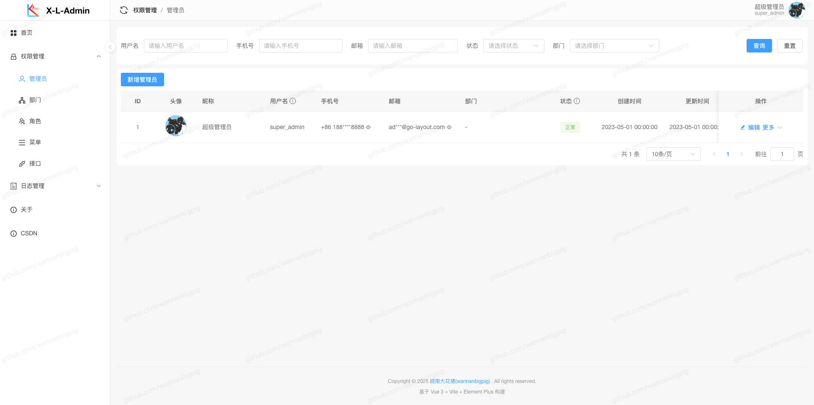

# X-L-Admin-Vue3

<div align="center">


基于 Vue 3 + Vite + Element Plus 的后台管理系统前端。

[在线演示](https://x-l-admin.wannanbigpig.com/) · [后端项目](https://github.com/wannanbigpig/gin-layout) · [API 文档](https://wannanbigpig.apifox.cn/)

</div>



## 项目简介

当前仓库以“动态菜单驱动的后台管理前端”为核心，围绕认证、权限、个人工作台、系统配置、文件中心、任务中心、日志审计和通知中心组织代码。前端通过后端返回的菜单树动态生成业务路由，并在本地统一处理：

- 登录、验证码与 token 静默刷新；
- 菜单路由与按钮权限；
- 中英文切换与主题切换；
- 请求封装、开发期 Mock、全局错误处理；
- WebSocket 通知、导出任务联动；
- 通用列表、表单、上传和字典加载能力。

## 当前功能范围

基于当前 `src/views`、`src/modules` 和 `src/router/componentMap.ts`，项目已包含以下主要页面与模块：

- 首页 / 仪表盘、我的待办、关于页、个人中心；
- 权限管理：管理员、部门、角色、菜单、API 权限；
- 日志中心：登录日志、请求日志、在线会话；
- 系统中心：系统参数、字典、文件中心、通知发送、任务中心、任务统计；个人导出记录由顶部入口进入“我的导出”；
- 业务示例：可替换的产品参考模块（仅用于演示 DataScope 与标准 CRUD，不是完整商品中心）；
- 静态辅助页：登录、404、iframe、refresh。

其中几个关键模块的当前实现特点如下：

- 文件中心支持目录树、分类筛选、网格/表格双视图、文件上传、目录上传、拖拽移动、批量操作、回收站、引用明细和导出。
- 任务中心通过 `definition`、`run`、`cron` 三个 Tab 管理任务定义、运行记录和 Cron 状态；“我的导出”独立展示当前登录用户的导出记录和下载入口，不展示任务运行 ID、队列及原始执行错误。
- 通知中心由 Pinia + WebSocket 驱动，带未读数、频道订阅、心跳保活和断线重连。
- 首页始终展示当前用户可见的登录信息、个人摘要、最近操作和待办卡片；全局运营指标与服务器监控仍按后端权限独立显示，没有全局权限时也不会出现空白工作台。
- 登录页采用聚焦表单的居中玻璃卡片，并与项目文档站首页统一细网格和视差圆环的动效语言；鼠标会更明显地推动低强度 Canvas 色团、网格和圆环，但不生成追随光标的独立光斑，卡片本身保持稳定。保留原验证码和认证协议，并完整适配浅色/深色主题、触屏设备、减少动态效果偏好、验证码加载/失败和登录失败状态。
- 个人日志默认隐藏查询日志页面自身产生的记录，可通过“日志查询记录”范围或操作名称重新筛出；普通用户看到自然语言变更摘要和 IP / 终端信息，管理员日志保留结构化详情。
- 待办表示“当前用户仍需完成的事项”，通知表示“需要知晓的信息”，任务中心表示“后台执行过程”。手工待办可直接管理；业务待办只提供站内业务跳转，状态由来源业务关闭，避免前端自行完成后与订单或审批状态不一致。

## 技术栈

- `Vue 3.5` + TypeScript 6
- `Vite 8` + Rolldown / Oxc
- `Vue Router 5`
- `Pinia 4` + `pinia-plugin-persistedstate 4`
- `Element Plus 2.14`
- `Axios 1.20`
- `Vue I18n 11`
- `Vitest 5` + `jsdom 30`

## 目录结构

```text
src
├── api
├── components
├── composables
├── directives
├── layout
├── locales
├── mock
├── modules
├── router
├── stores
├── types
├── utils
└── views
```

更细的模块和页面映射见：

- [docs/project-overview.md](docs/project-overview.md)
- [docs/runtime-guide.md](docs/runtime-guide.md)

## 环境要求

- `Node.js ^22.13.0、^24.0.0 或 >= 26.0.0`
- `pnpm 12.4.1`（由 `packageManager` 固定）

项目只维护 `pnpm-lock.yaml`，并统一使用 TypeScript 6 稳定版，确保与 Vue、`vue-tsc` 和 ESLint 工具链保持在同一条受支持链路上。

## 快速开始

### 1. 安装依赖

```bash
corepack pnpm install --frozen-lockfile
```

### 2. 启动开发环境

```bash
corepack pnpm run dev
```

可选启动方式：

```bash
# 读取 .env.location
corepack pnpm run local

# 使用 production mode 启动 Vite
corepack pnpm run prod
```

### 3. 构建

```bash
corepack pnpm run build:dev
corepack pnpm run build:production
corepack pnpm run preview
```

### 4. 校验与测试

```bash
corepack pnpm run type-check
corepack pnpm run lint
corepack pnpm run test:run
corepack pnpm run test:coverage
```

## 环境变量重点

项目已提供 `.env.example`、`.env.development`、`.env.location`、`.env.production`。当前代码实际使用的关键变量包括：

- `VITE_APP_TITLE`
- `VITE_ENABLE_I18N`
- `VITE_DEFAULT_LOCALE`
- `VITE_APP_BASE`
- `VITE_BASE_URL`
- `VITE_BASE_API`
- `VITE_BASE_STATIC`
- `VITE_PROXY_TARGET`
- `VITE_USE_PROXY`
- `AUTO_OPEN_BROWSER`

代码中还支持以下可选变量：

- `VITE_ENABLE_MOCK`
- `VITE_ENABLE_MOCK_FALLBACK`
- `VITE_NOTIFICATION_WS_URL`
- `VITE_IFRAME_ALLOWED_ORIGINS`
- `VITE_DEV_USERNAME`
- `VITE_DEV_PASSWORD`

详细说明见 [docs/runtime-guide.md](docs/runtime-guide.md)。

## 运行机制摘要

- `src/router/guard.ts` 负责登录态校验、静默刷新 token、动态路由注入和页面标题更新。
- `src/router/dynamicRoutes.ts` 负责把后端菜单树转换成前端路由，并过滤按钮节点。
- `src/stores/auth.ts` 负责用户信息、菜单树、按钮权限和 token 生命周期；退出或切换账号时会同时失效 API 缓存与旧异步请求。
- `src/utils/request.ts` 负责请求封装、响应标准化、401 刷新和开发期 Mock。
- `src/stores/notification.ts` 负责通知列表、未读数、WebSocket 心跳和重连，并通过连接代次丢弃旧会话的异步结果。

Vite 开发服务器会在启动期预构建当前 Element Plus 的组件样式入口，避免首次访问懒加载菜单时因补做 dependency optimization 触发整页刷新；生产环境使用预构建产物，不走该开发期优化器。

## 文档导航

- [项目总览](docs/project-overview.md)
- [运行机制说明](docs/runtime-guide.md)
- [前后端兼容与版本策略](docs/compatibility.md)
- [贡献指南](CONTRIBUTING.md)
- [安全策略](SECURITY.md)
- [变更记录](CHANGELOG.md)
- [路线图](ROADMAP.md)

## 验证命令

文档更新后，建议至少执行：

```bash
corepack pnpm run lint
corepack pnpm run type-check
corepack pnpm run test:coverage
corepack pnpm run build:production
```

## 许可证

[MIT](LICENSE)

版本仅在 `package.json` 手工维护，兼容范围和升级说明入口在 `docs/release.json`。发布前运行 `pnpm run check:release`、`pnpm run test:release`；构建输出 `build-info.json`。后台与后端独立发布；官网不维护独立版本，API 文档可切换后端正式 Release，自动发现并核对配套后台 Tag，在线阅读对应资料；已发布版本与实际部署版本分别核对，详见 [版本与升级策略](docs/compatibility.md)。
